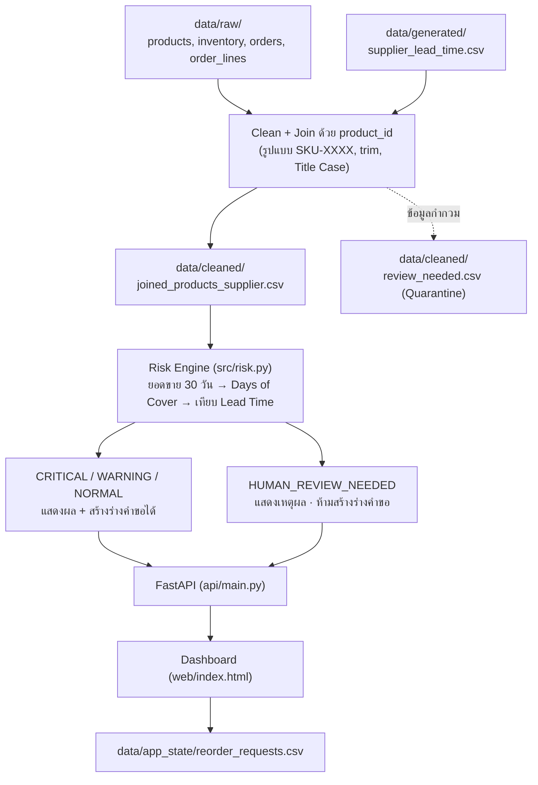

<div align="center">

# 📦 BaanDee Stockout Radar

### ระบบช่วยตรวจสอบสินค้าที่เสี่ยงขาดสต็อก และสร้างร่างคำขอสั่งซื้อ

*Data Product Prototype · Final Project · รายวิชา Data Product Development*
*บริษัทสมมติ: BaanDee Living*


</div>

> **ระบบหลัก:** ตรวจว่าสินค้าใดเสี่ยงขาดสต็อก พร้อมบอกว่า **"ควรสั่งภายในกี่วัน"**
> **ระบบรอง:** ปุ่มสร้าง **ร่างคำขอสั่งซื้อภายใน** ให้หัวหน้าอนุมัติ (ไม่ใช่ใบสั่งซื้อจริง)

---

## 📑 สารบัญ

1. [ปัญหา ผู้ใช้ และคุณค่าที่คาดหวัง](#-1-ปัญหา-ผู้ใช้-และคุณค่าที่คาดหวัง)
2. [แหล่งข้อมูลและคุณภาพข้อมูล](#-2-แหล่งข้อมูลและคุณภาพข้อมูล)
3. [สถาปัตยกรรมและกฎประเมินความเสี่ยง](#-3-สถาปัตยกรรมและกฎประเมินความเสี่ยง)
4. [โครงสร้าง Repository](#-4-โครงสร้าง-repository)
5. [วิธีติดตั้งและรันระบบ](#-5-วิธีติดตั้งและรันระบบ)
6. [กรณีสาธิตหลัก](#-6-กรณีสาธิตหลัก)
7. [ผลการทดสอบ](#-7-ผลการทดสอบ)
8. [ข้อจำกัดและความเสี่ยง](#️-8-ข้อจำกัดและความเสี่ยง)
9. [เหตุผลที่ไม่ใช้ AI ในตัวผลิตภัณฑ์](#-9-เหตุผลที่ไม่ใช้-ai-ในตัวผลิตภัณฑ์)
10. [สมาชิกในทีม](#-10-สมาชิกในทีมและบทบาทหน้าที่)
11. [ลิงก์สำคัญ](#-11-ลิงก์สำคัญ)

---

## 🎯 1. ปัญหา ผู้ใช้ และคุณค่าที่คาดหวัง

| หัวข้อ | รายละเอียด |
|---|---|
| 👤 **ผู้ใช้หลัก** | เจ้าหน้าที่จัดซื้อและวางแผนสต็อก (Procurement / Stock Planning Staff) และหัวหน้าฝ่ายจัดซื้อ (Procurement Manager) ผู้พิจารณาอนุมัติร่างคำขอ |
| 🎯 **งานที่ผู้ใช้ต้องทำ** | ตัดสินใจทุกวันว่าควรสั่งสินค้ารายการใด จำนวนเท่าไร และเร่งด่วนเพียงใด ก่อนสินค้าหมดคลัง โดยดูจากสต็อกคงเหลือ ยอดขายเฉลี่ยต่อวันย้อนหลัง 30 วัน และระยะเวลาจัดส่งของซัพพลายเออร์ (Lead Time) |
| 😣 **ปัญหาปัจจุบัน** | • ข้อมูลสินค้า สต็อก ยอดขาย และ Lead Time กระจายอยู่คนละแหล่ง เสียเวลารวบรวมเอง<br>• ไม่มีเกณฑ์กลางประเมินความเสี่ยง แต่ละคนตัดสินใจต่างกัน<br>• ดูแค่จำนวนสต็อกไม่บอกความเร่งด่วน<br>• ข้อมูลที่ไม่ครบหรือผิดปกติมักถูกละเลยหรือใช้การคาดเดาแทน |

### 💡 ต้นแบบนี้ช่วยอย่างไร

- **รวมข้อมูลหลายแหล่งไว้ที่เดียว** เชื่อมด้วย `product_id` และแสดงบน Dashboard เดียว
- **ประเมินความเสี่ยงด้วยกฎที่แน่นอน** (Deterministic Rule) ไม่ใช้ AI ทำให้ตรวจสอบที่มาของตัวเลขได้ทุกตัว
- **บอกความเร่งด่วนเป็น "จำนวนวัน"** จาก `Days of Cover − Lead Time` (ค่าติดลบ = เลยกำหนดที่ควรสั่งแล้ว)
- **แยกข้อเท็จจริงออกจากค่าประมาณ** ข้อเท็จจริงจากฐานข้อมูล: สต็อก, Lead Time, MOQ / ค่าประมาณ: ยอดขายเฉลี่ย, จำนวนที่แนะนำให้สั่ง
- **ไม่เดาข้อมูลที่ไม่ชัดเจน** ถ้าข้อมูลไม่ครบหรือผิดปกติ ระบบแสดงสถานะ `HUMAN_REVIEW_NEEDED` พร้อมเหตุผล และ **ระงับการสร้างร่างคำขอ** จนกว่าคนจะตรวจสอบ

### 🔬 สมมติฐานที่ยังต้องทดลองกับผู้ใช้จริง

| รหัส | สมมติฐาน |
|:-:|---|
| **H1** | Dashboard ที่รวมข้อมูลในหน้าจอเดียวช่วยลดเวลาที่เจ้าหน้าที่ใช้ตรวจสินค้าเสี่ยงได้จริง |
| **H2** | เกณฑ์จัดระดับความเสี่ยงของระบบสอดคล้องกับการตัดสินใจของผู้เชี่ยวชาญด้านจัดซื้อและวางแผนสต็อก |
| **H3** | การแสดง `HUMAN_REVIEW_NEEDED` พร้อมเหตุผล และการระงับการสร้างร่างคำขอ ช่วยลดความผิดพลาดจากการคาดเดาข้อมูลได้จริง |

---

## 📊 2. แหล่งข้อมูลและคุณภาพข้อมูล

### 2.1 แหล่งข้อมูล

| โฟลเดอร์ | ไฟล์ | หมายเหตุ |
|---|---|---|
| `data/raw/` | `products`, `inventory_snapshot`, `orders`, `order_lines`, `customers`, `support_tickets`, `delay_policy.json` | ข้อมูลดิบ 7 ไฟล์ (ไม่แก้ทับ) · สต็อก ณ **31 ก.ค. 2026** |
| `data/generated/` | `supplier_lead_time.csv` | ข้อมูลแหล่งที่ 2 ที่สังเคราะห์ขึ้น ฝังข้อมูลบกพร่องไว้ทดสอบพฤติกรรมเมื่อข้อมูลผิดพลาด (Failure Behavior) |
| `data/cleaned/` | `cleaned_products`, `cleaned_inventory_snapshot`, `cleaned_orders`, `cleaned_order_lines`, `joined_products_supplier`, `review_needed` | ผลการทำความสะอาด, Left Join สินค้ากับซัพพลายเออร์ และรายการที่ถูกกักกันให้คนตรวจ |
| `data/app_state/` | `reorder_requests.csv` | สถานะร่างคำขอที่สร้างจากหน้าเว็บ (สร้างอัตโนมัติเมื่อใช้งานครั้งแรก) |

> 📅 **Snapshot Date** คือวันที่ของข้อมูลสต็อกที่นำมาวิเคราะห์ ไม่ใช่วันที่ปัจจุบัน ชุดข้อมูลนี้กำหนดเป็น **31 กรกฎาคม 2026** ผลวิเคราะห์จึงเป็นภาพ ณ วันดังกล่าว ไม่ใช่ข้อมูลเรียลไทม์

### 2.2 ลำดับการประมวลผลข้อมูล



- **Join Rule:** ใช้ `product_id` รูปแบบมาตรฐาน `SKU-XXXX` เป็นกุญแจเชื่อมตาราง
- **Quarantine Rule:** รายการที่ Lead Time เป็น `NaN` / ติดลบ, รหัส SKU ผิดรูปแบบ หรือไม่พบสต็อก จะได้สถานะ `HUMAN_REVIEW_NEEDED` พร้อม `review_reason` และระบบ **ไม่เดาค่าแทน**

### 2.3 ปัญหาคุณภาพข้อมูลที่พบและวิธีจัดการ

หลักการ: ระบบ **ไม่ปรับแก้ข้อมูลที่ไม่ชัดเจนเอง** แต่แยกเป็น 2 ส่วน คือ *Cleaned Data* สำหรับข้อมูลที่ผ่านการตรวจสอบ และ *Quarantine* สำหรับข้อมูลที่ต้องให้คนตรวจ

| # | ปัญหา | หลักฐาน | วิธีตรวจพบ | วิธีจัดการ | ก่อน → หลัง |
|:-:|---|---|---|---|---|
| 1 | ชื่อหมวดสินค้าสะกดไม่เป็นมาตรฐาน | `kitchen`/`Kitchen`, `bedding`/`Bedding`, `Bed room` ใน `products.csv` | นับจำนวนและรูปแบบชื่อหมวดหมู่ | ตัดช่องว่างส่วนเกิน ปรับตัวอักษรให้เป็นรูปแบบเดียวกัน และจัดให้เหลือ 4 หมวดมาตรฐาน | 8 หมวดสะกดปนกัน → **4 หมวดมาตรฐาน** ใน `cleaned_products.csv` |
| 2 | รูปแบบวันที่ปนกันและกำกวม | `28/07/2026`, `07/08/2026` และค่า Null ใน `orders.csv` | ตรวจว่าเป็น `YYYY-MM-DD` หรือไม่ และตรวจค่าว่าง | แปลงวันที่ชัดเจนเป็น `YYYY-MM-DD` ส่วนที่กำกวม/ขาดหายส่งเข้า `review_needed.csv` | รูปแบบปนกัน → แปลงเป็น `YYYY-MM-DD` และแยก **1 รายการ** ไป `review_needed.csv` |
| 3 | รหัส SKU ผิดฟอร์แมต | `SKU-BD-220`, `SKU-KT-104` ใน `products.csv` | ตรวจว่าขึ้นต้น `SKU-` ตามด้วยเลข 4 หลักหรือไม่ | กักกันไว้ใน `review_needed.csv` ให้คนตรวจ ไม่เดาค่าแทน | มีรหัสผิดปกติ 2 รายการ → **คัดแยกไป `review_needed.csv`** |
| 4 | วันที่สั่งซื้อเป็นข้อมูลเก่า | `order_date` ก่อนปี 2026 (เช่น `2025-01-01`) 1 รายการใน `orders.csv` | ตรวจปีของ `order_date` | กักกันส่งเข้า `review_needed.csv` ให้คนตรวจ | มีรายการปีเก่าปนอยู่ → **คัดแยกไป `review_needed.csv`** |

---

## 🧮 3. สถาปัตยกรรมและกฎประเมินความเสี่ยง

### 3.1 กฎประเมินความเสี่ยง (ไม่ใช้ AI)

```
Days of Cover = สต็อกคงเหลือ ÷ ยอดขายเฉลี่ยต่อวัน (ย้อนหลัง 30 วันจาก Snapshot)
```

| ระดับ | เงื่อนไข | ความหมาย |
|---|---|---|
| 🔴 `CRITICAL_RISK` เสี่ยงสูง | Days of Cover **<** Lead Time (หรือสต็อก = 0) | ของจะหมดก่อนของใหม่มาถึง |
| 🟠 `WARNING_RISK` เสี่ยงปานกลาง | Lead Time ≤ Days of Cover ≤ Lead Time + 7 | เหลือเวลาสั่งไม่นาน |
| 🟢 `NORMAL` ยังไม่เสี่ยง | Days of Cover > Lead Time + 7 (หรือไม่มียอดขาย) | สต็อกเพียงพอ |
| 🟣 `HUMAN_REVIEW_NEEDED` ต้องให้คนตรวจ | Lead Time ขาด / ≤ 0, สต็อกขาด / ติดลบ, SKU ผิดรูปแบบ | ข้อมูลไม่พอ ระบบไม่เดา |

**สูตรที่เกี่ยวข้อง**

- **ควรสั่งภายใน (วัน)** = `Days of Cover − Lead Time` ค่าติดลบหมายถึง *เลยช่วงที่ควรสั่งแล้ว* (ไม่ใช่จำนวนวันที่เหลือก่อนสินค้าหมด)
- **จำนวนแนะนำ (ค่าประมาณ)** = `ยอดขายเฉลี่ยต่อวัน × (Lead Time + 14 วันสำรอง) − สต็อกคงเหลือ` โดยกำหนดค่าต่ำสุดเป็น 0 และถ้าต้องสั่ง จะปัดขึ้นเป็นจำนวนเต็มเท่าของ **MOQ**
- **ยอดขายเฉลี่ยเป็นศูนย์:** ระบบไม่หารด้วยศูนย์ และจัดเป็น `NORMAL` เพราะไม่มีการขายที่ทำให้สต็อกหมด

### 3.2 Tech Stack

| ส่วนงาน | เทคโนโลยี |
|---|---|
| Backend / Analytics | Python 3.11+, `pandas`, `numpy` |
| API | `FastAPI` + `Uvicorn` |
| Frontend | HTML / CSS / JavaScript (`web/index.html`) ให้บริการโดย FastAPI |
| Storage | CSV (`data/app_state/reorder_requests.csv`) |
| Testing | สคริปต์ทดสอบอัตโนมัติ `tests/test_system.py` |

### 3.3 API Endpoints

| Method | Path | หน้าที่ |
|:-:|---|---|
| `GET` | `/api/summary` | จำนวนสินค้าแต่ละระดับ, วัน Snapshot, รายการหมวด |
| `GET` | `/api/risk` · `/api/risk/{product_id}` | รายการ / รายละเอียดความเสี่ยง (กรองด้วย `status`, `category`, `q`) |
| `GET` | `/get_supplier_lead_time_api?product_id=` | **จุดเชื่อมต่อข้ามระบบ** ดึง Lead Time ซัพพลายเออร์ |
| `GET` / `POST` | `/api/requests` | ดู / สร้างร่างคำขอ (Create, Read) |
| `PATCH` | `/api/requests/{id}` | แก้จำนวน / อนุมัติ (Update) |
| `DELETE` | `/api/requests/{id}` | ซ่อนรายการ (Soft Delete) |

**API ข้ามระบบ `/get_supplier_lead_time_api` ตอบกลับ 3 สถานการณ์**

| HTTP | เมื่อใด | ผลลัพธ์ |
|:-:|---|---|
| ✅ `200 OK` | พบ SKU และข้อมูลผ่านการตรวจสอบ | คืน `product_id`, `supplier_name`, `lead_time_days` |
| ⚠️ `404 Not Found` | ไม่พบ SKU ที่ร้องขอ | แจ้งว่าไม่พบข้อมูล |
| ❌ `503 Service Unavailable` | ไฟล์ข้อมูลซัพพลายเออร์ขาดหายหรืออ่านไม่ได้ | แจ้งว่าบริการไม่พร้อมใช้งาน |

### 3.4 ร่างคำขอสั่งซื้อ (ฟังก์ชันรอง)

- **ฟิลด์ที่บันทึก:** `request_id`, `product_id`, `product_name`, `requested_qty`, `risk_status` (ณ วันสร้าง), `status` (`Draft` → `Approved`), `created_at`, `updated_at`, `is_deleted`
- เป็น **ร่างภายใน** ให้หัวหน้าอนุมัติ **ไม่ส่งคำสั่งซื้อจริงไปยังซัพพลายเออร์** (Human-in-the-loop)
- สินค้าที่เป็น `HUMAN_REVIEW_NEEDED` **สร้างร่างไม่ได้** (API ตอบ `409`)
- **Soft Delete** ตั้ง `is_deleted = True` โดยไม่ลบแถวออกจากไฟล์ เพื่อให้ตรวจย้อนหลังได้ (Audit Trail)

---

## 📂 4. โครงสร้าง Repository

```
baandee-final-prototype/
├── api/
│   └── main.py              # FastAPI: Risk API, Lead Time API, CRUD ร่างคำขอ, เสิร์ฟหน้าเว็บ
├── src/
│   ├── risk.py              # เอนจินคำนวณ Days of Cover และจัดระดับความเสี่ยง
│   └── storage.py           # CRUD ร่างคำขอ (Draft / Approve / Soft Delete) ลง CSV
├── web/
│   └── index.html           # หน้า Dashboard (ตรวจความเสี่ยง + ร่างคำขอสั่งซื้อ)
├── data/
│   ├── raw/  generated/  cleaned/  app_state/
├── tests/
│   ├── conftest.py
│   └── test_system.py       # ชุดทดสอบอัตโนมัติ 5 กรณี (ใช้ข้อมูลชั่วคราว)
├── docs/
│   └── VSCODE_SETUP.md      # วิธีรันบน VS Code และแก้ปัญหาที่พบบ่อย
├── .vscode/                 # launch.json (กด F5 รันเว็บ), settings.json
├── run.bat / run.sh         # ทางลัดติดตั้งและรัน
├── TEST_CASES.md            # รายงานผลทดสอบฉบับเต็ม
├── AI_USE.md                # รายงานการใช้งาน AI
├── requirements.txt
├── .env.example
├── .gitignore
└── README.md
```

---

## 🚀 5. วิธีติดตั้งและรันระบบ

### ตัวเลือก A: รันบนเครื่องตัวเอง

```bash
# 1. Clone
git clone https://github.com/67011216001/baandee-final-prototype.git
cd baandee-final-prototype

# 2. สร้าง Virtual Environment แล้วติดตั้งไลบรารี
python -m venv .venv
source .venv/bin/activate        # Windows (PowerShell): .venv\Scripts\Activate.ps1
pip install -r requirements.txt

# 3. รันระบบ
python -m uvicorn api.main:app --reload
```

เปิดเบราว์เซอร์ที่ **http://127.0.0.1:8000**

| ระบบ | ทางลัด |
|---|---|
| Windows | ดับเบิลคลิก `run.bat` |
| macOS / Linux | `./run.sh` |
| VS Code | กด **F5** เลือก "BaanDee: รันเว็บ (FastAPI)" |

### ตัวเลือก B: รันบน GitHub Codespaces

1. กด **Code → Codespaces → Create codespace on main**
2. เปิด Terminal แล้วรัน `bash run.sh`
3. เปิดแท็บ **Ports** แล้วคลิกไอคอนลูกโลกที่พอร์ต **8000**

> ⚠️ ต้องเปิดผ่านเซิร์ฟเวอร์เท่านั้น **ห้ามดับเบิลคลิก `index.html` ตรง ๆ** เพราะหน้าเว็บต้องเรียก `/api/...`
> ปัญหาที่พบบ่อยดู [`docs/VSCODE_SETUP.md`](./docs/VSCODE_SETUP.md)

### รันชุดทดสอบ

```bash
python tests/test_system.py
```

---

## 🎬 6. กรณีสาธิตหลัก

### ✅ กรณีที่ 1: ตรวจความเสี่ยงจนถึงอนุมัติร่างคำขอ (End-to-End Success Flow)

| ขั้น | การทำงาน |
|:-:|---|
| 1️⃣ | **คัดกรองสินค้า:** เปิดหน้า *ตรวจความเสี่ยง* แล้วคลิกการ์ดระดับความเสี่ยง (เสี่ยงสูง / เสี่ยงปานกลาง / ยังไม่เสี่ยง) ระบบแสดงรายการสินค้าตามระดับที่เลือก |
| 2️⃣ | **ประเมินความเร่งด่วน:** คลิกสินค้าเพื่อดูสต็อกคงเหลือ ยอดขายเฉลี่ยต่อวัน Lead Time สต็อกพอขาย (Days of Cover) และจำนวนที่แนะนำให้สั่ง |
| 3️⃣ | **สร้างร่างคำขอ:** กด *สร้างร่างคำขอ* ระบบสร้างร่างจากสินค้าที่เลือกเพื่อให้ผู้ใช้ตรวจสอบก่อนดำเนินการต่อ |
| 4️⃣ | **ตรวจและอนุมัติ:** เปิดแท็บ *ร่างคำขอสั่งซื้อ* แก้จำนวนที่ต้องการ แล้วกด *อนุมัติ* (ยังไม่ถือเป็นการสั่งซื้อจริง) |
| 5️⃣ | **ตรวจการบันทึก:** ปิดแล้วเปิดโปรแกรมใหม่ กลับมาที่แท็บ *ร่างคำขอสั่งซื้อ* รายการยังอยู่ครบ |

**ผลลัพธ์ที่คาดหวัง:** ผู้ใช้ตรวจความเสี่ยง สร้างและแก้ไขร่างคำขอได้ และข้อมูลยังคงอยู่หลังเปิดโปรแกรมใหม่

### 🛑 กรณีที่ 2: ระบบหยุดและส่งต่อให้คนตรวจ (Failure & Human Review Flow)

| ขั้น | การทำงาน |
|:-:|---|
| 1️⃣ | **คัดกรอง:** เปิดหน้า *ตรวจความเสี่ยง* แล้วคลิกการ์ด *ต้องให้คนตรวจ* |
| 2️⃣ | **ตรวจข้อมูลผิดปกติ:** เลือกสินค้าที่มีปัญหา เช่น **SKU-0015** ที่ Lead Time เป็น `NaN` ไม่สามารถนำไปคำนวณได้ |
| 3️⃣ | **ระงับการสร้างร่าง:** ระบบแสดงเหตุผล และ **ไม่อนุญาตให้สร้างร่างคำขอ** สำหรับรายการนี้ |

**ผลลัพธ์ที่คาดหวัง:** ผู้ใช้ทราบสาเหตุที่ประเมินตามปกติไม่ได้ และระบบไม่สร้างร่างคำขอจนกว่าข้อมูลจะได้รับการตรวจสอบ

### 🗑️ กรณีที่ 3: ลบรายการแบบซ่อนข้อมูล (Soft Delete)

| ขั้น | การทำงาน |
|:-:|---|
| 1️⃣ | **เลือกรายการ:** เปิดแท็บ *ร่างคำขอสั่งซื้อ* แล้วเลือกรายการที่ต้องการนำออก |
| 2️⃣ | **ลบ:** กดลบ ระบบซ่อนรายการจากหน้าจอ แต่ **ไม่ลบแถวออกจากไฟล์ CSV** |
| 3️⃣ | **ตรวจสถานะ:** เปิด `reorder_requests.csv` จะพบแถวเดิมยังอยู่ พร้อม `is_deleted = True` |

**ผลลัพธ์ที่คาดหวัง:** รายการไม่แสดงบนหน้าจอปกติ แต่ข้อมูลเดิมยังอยู่ในไฟล์พร้อมสถานะที่ระบุว่าถูกลบแล้ว

---

## 🧪 7. ผลการทดสอบ

รันด้วย `python tests/test_system.py` · ผลล่าสุด **✅ 5/5 tests passed**
รายละเอียดเต็ม (Input, Expected, Actual) ดู [**TEST_CASES.md**](./TEST_CASES.md)

| รหัส | กรณีทดสอบ | สิ่งที่ตรวจ | สถานะ |
|:-:|---|---|:-:|
| TC-01 | Invalid Data Detection and Human Review | ระบบจับข้อมูลผิดปกติ (พบ 5 รายการ) และมีเหตุผลกำกับครบทุกรายการ | ✅ PASS |
| TC-02 | Supplier API Boundary Handling | API ตอบ `200` / `404` / `503` ถูกต้องตามเงื่อนไข | ✅ PASS |
| TC-03 | Stock Risk Calculation Engine | คำนวณความเสี่ยง 82 SKUs และพบ `CRITICAL_RISK` กับ `HUMAN_REVIEW_NEEDED` | ✅ PASS |
| TC-04 | Reorder Request Create and Update | สร้างร่างเป็น `Draft` แล้วอนุมัติเป็น `Approved` ได้ | ✅ PASS |
| TC-05 | Soft Delete and Audit Trail | ซ่อนจากรายการปกติ แต่เก็บประวัติและ `is_deleted = True` | ✅ PASS |

---

## ⚠️ 8. ข้อจำกัดและความเสี่ยง

| # | ข้อจำกัด | รายละเอียด |
|:-:|---|---|
| 1 | **ข้อมูล ณ วันอ้างอิงคงที่** | ใช้ข้อมูลสต็อก ณ 31 กรกฎาคม 2026 ผลประเมินจึงไม่ใช่สถานะสต็อกปัจจุบันหรือแบบเรียลไทม์ |
| 2 | **ยอดขายเฉลี่ยเป็นค่าประมาณ** | คำนวณจากยอดขายย้อนหลัง 30 วัน ไม่ได้พยากรณ์ด้วย Machine Learning อาจคลาดเคลื่อนหากข้อมูลยอดขายไม่ครบ หรือการยกเลิก/คืนสินค้ายังจัดการได้ไม่ครอบคลุม |
| 3 | **กรณียอดขายเป็นศูนย์** | ระบบจัดสินค้าที่ไม่มียอดขายเป็น `NORMAL` เพื่อไม่ให้หารด้วยศูนย์ แต่ยังแยกไม่ได้ว่า "ไม่มีการขายจริง" หรือ "ข้อมูลยอดขายตกหล่น" |
| 4 | **เป็นร่างคำขอเท่านั้น** | ระบบไม่ส่งคำสั่งซื้อไปยังซัพพลายเออร์ การอนุมัติร่างจึงไม่ใช่การสั่งซื้อจริง |
| 5 | **ข้อมูลสังเคราะห์** | ใช้ Synthetic Data จึงยังยืนยันไม่ได้ว่าผลสอดคล้องกับสถานการณ์จริง และสมมติฐาน H1–H3 ยังต้องทดลองกับผู้ใช้จริง |
| 6 | **ยังไม่มีระบบล็อกอินและสิทธิ์ผู้ใช้** | การกดอนุมัติเป็นเพียงการสาธิตการเปลี่ยนสถานะ ยังยืนยันตัวตนหรือควบคุมสิทธิ์ผู้อนุมัติไม่ได้ ต้องเพิ่มกลไกนี้ก่อนนำไปใช้จริง |

---

## 🤖 9. เหตุผลที่ไม่ใช้ AI ในตัวผลิตภัณฑ์

ระบบประเมินความเสี่ยงด้วย **กฎธุรกิจที่ชัดเจน** (เปรียบเทียบ Days of Cover กับ Lead Time) จึงใช้โค้ด Python แทน AI/LLM เพราะ

- ✔️ **ผลลัพธ์สม่ำเสมอ** ข้อมูลเดิมได้คำตอบเดิมทุกครั้ง
- ✔️ **ตรวจสอบที่มาได้** ทุกตัวเลขย้อนกลับไปที่สูตรได้
- ✔️ **ไม่สร้างตัวเลขที่ไม่มีข้อมูลรองรับ**

AI ถูกใช้เป็นเครื่องมือช่วย **พัฒนาและปรับปรุงระบบ** เท่านั้น ไม่ได้ใช้คำนวณความเสี่ยงขณะระบบทำงาน (รายละเอียดดู [**AI_USE.md**](./AI_USE.md))

---

## 👥 10. สมาชิกในทีมและบทบาทหน้าที่

| # | รหัสนิสิต | ชื่อ - นามสกุล | บทบาท |
|:-:|:-:|---|---|
| 1 | `67011216002` | พรพรรณ นันตะเวช | **Data Cleaning & Inspection:** สำรวจคุณภาพข้อมูลดิบ 7 ไฟล์ ทำความสะอาด และคัดแยกข้อมูลกำกวม |
| 2 | `67011216004` | นิตยา บุตรดีขันธ์ | **Synthetic Data & Risk Calculation:** สร้าง `supplier_lead_time.csv` พร้อมเคสทดสอบ, Data Join และเอนจินคำนวณความเสี่ยง |
| 3 | `67011216001` | ณัฐรีญา ศรีดาวงษ์ | **GitHub & UI Prototype:** จัดการ Repository, ระบบบันทึกร่างคำขอ (Storage) และหน้า Dashboard |
| 4 | `67011216014` | กัญญาณัฐ สีแสงน้อย | **Testing & Documentation:** ออกแบบและรันทดสอบ, จัดทำ README / AI_USE / TEST_CASES และสไลด์นำเสนอ |

---

## 🔗 11. ลิงก์สำคัญ

| รายการ | ลิงก์ |
|---|---|
| 📁 Repository | [github.com/67011216001/baandee-final-prototype](https://github.com/67011216001/baandee-final-prototype) |
| 🧪 รายงานผลทดสอบ | [TEST_CASES.md](./TEST_CASES.md) |
| 🤖 รายงานการใช้ AI | [AI_USE.md](./AI_USE.md) |
| 🛠️ วิธีรันบน VS Code | [docs/VSCODE_SETUP.md](./docs/VSCODE_SETUP.md) |
| 🌐 เดโมออนไลน์ | *(ใส่ลิงก์ Render / วิดีโอเดโม ที่นี่ ถ้ามี)* |
